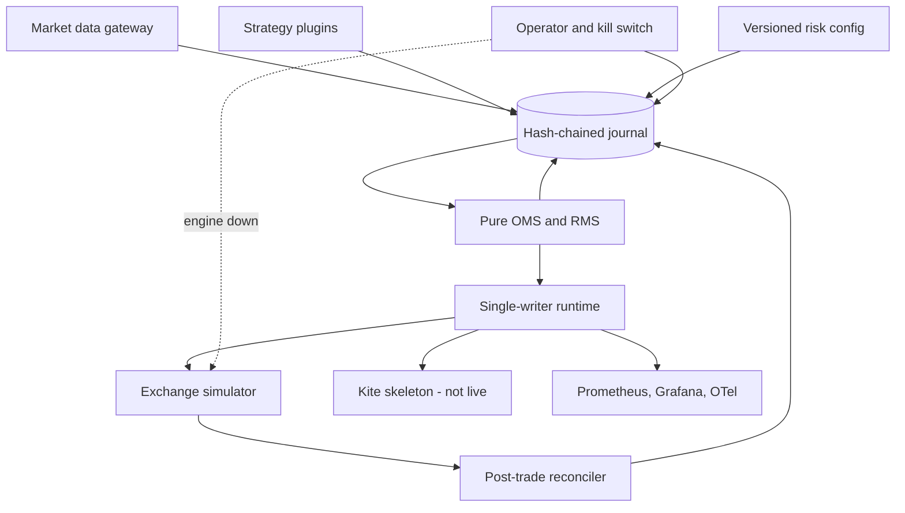

# Algorithmic trading foundation for Indian markets

Paper-trading core for NSE and BSE equity cash, NSE and BSE equity and currency derivatives, and MCX commodities. Orders are journaled, risk-checked, and sent only through a gateway. The deterministic core does not read a clock, open a socket, or draw a random number. This build talks to an exchange simulator. It refuses to start in live mode.

The internal path is the pure state machine plus the journal append. The latency budget beyond that is the broker and the exchange. Target for a later live deployment: under 100 ms from signal to the order leaving the process, with the in-process hot path in single-digit milliseconds. Histograms are `atp_hot_path_ms` and `atp_e2e_ms` (p50 / p99 / p99.9 on `GET /latency`).

## Run the demo

```bash
./scripts/demo.sh
```

That compiles the engine, runs seven strategies against the simulator on a fixed session clock (Wednesday 7 January 2026, 10:00 IST), prints every order, and checks that a replay of the journal matches. Metrics stay up when you set `HOLD_SECS`:

```bash
HOLD_SECS=3600 ./scripts/demo.sh
```

- Metrics: [http://127.0.0.1:18420/metrics](http://127.0.0.1:18420/metrics)
- State: [http://127.0.0.1:18420/state](http://127.0.0.1:18420/state)
- Traces: [http://127.0.0.1:18420/traces](http://127.0.0.1:18420/traces)
- Latency: [http://127.0.0.1:18420/latency](http://127.0.0.1:18420/latency)

Grafana, Prometheus, and an OpenTelemetry collector:

```bash
docker compose up --build
```

Grafana is [http://127.0.0.1:13300](http://127.0.0.1:13300) (anonymous admin). Prometheus is [http://127.0.0.1:19090](http://127.0.0.1:19090). The ATP folder has **Order lifecycle** and **Latency**. Alert rules cover stale feed, recon mismatch, reject spikes, latency SLO breach, and a latched kill switch.

Tests and the same demo are what CI runs: `cargo test --workspace` and `./scripts/demo.sh`.

## Architecture

One process is the single writer for one account partition. State is the fold of an append-only, hash-chained journal. Strategies see market and position snapshots and return intents. They do not receive a broker handle. The runtime executes the outbox (send, cancel, replace, query) and is the only place that reads `Instant` or a socket.



Fail closed when risk is uncertain, a feed is stale or gapped, an order is `UNKNOWN`, margin is unavailable, or reconciliation disagrees. A mismatch halts the partition. Resume does not rewrite the books.

Paper mode is the default. `--mode live` exits before any order is built. Paper also refuses the Kite gateway, so a mis-set flag cannot leak an intent to that adapter.

### Layout

| Path | Role |
| --- | --- |
| `crates/atp_core` | Journal, OMS table, RMS, instruments, strategies. No I/O. |
| `crates/atp_runtime` | Simulator, Kite skeleton, engine, replay, kill switch. |
| `config/instruments.toml` | Sample book, all four segments. |
| `config/risk.toml` | Versioned limits. Hot reload must increase `version`. |
| `deploy/` | Prometheus alerts, Grafana dashboards, OTel collector. |
| `sdk/python` | Research-only intent helper. Not on the order path. |
| `docs/RUNBOOK.md` | Startup, kill, journal recovery, recon failures. |
| `docs/ROADMAP.md` | Paper, then small capital, then scale. |

Prices are `i64` in INR × 10,000 so paise and the 0.0025 currency tick are exact. Notional is `price * qty` in that unit. Limits in TOML are decimal INR strings.

Client order ids are 1–20 characters, `[A-Za-z0-9-]`. A freeze slice is `{intent}-{n}`. A replace successor is `{id}r{seq}`. Retries reuse the id. The runtime queries status before a resend. The first send is journaled as `SENT` before the socket call. `UNKNOWN` is resolved only from a broker view.

## Order state transitions

The only edges are `TRANSITIONS` in `crates/atp_core/src/oms.rs`. Anything else is rejected. Terminal states are `RISK_REJECTED`, `REJECTED`, `FILLED`, `CANCELLED`, `REPLACED`, and `EXPIRED`. `UNKNOWN` is not terminal.

A partial fill during `CANCEL_PENDING` or `REPLACE_PENDING` updates quantity and stays in that state. A completing fill moves to `FILLED`.

| From | Trigger | To |
| --- | --- | --- |
| NEW | RiskApprove | RISK_APPROVED |
| NEW | RiskReject | RISK_REJECTED |
| RISK_APPROVED | Dispatch | SENT |
| RISK_APPROVED | DispatchUncertain | UNKNOWN |
| RISK_APPROVED | Withdraw | CANCELLED |
| SENT | Ack | ACKED |
| SENT | BrokerReject | REJECTED |
| SENT | FillPartial | PARTIALLY_FILLED |
| SENT | FillComplete | FILLED |
| SENT | CancelRequest | CANCEL_PENDING |
| SENT | ReplaceRequest | REPLACE_PENDING |
| SENT | TimeoutUnknown / DisconnectUnknown | UNKNOWN |
| SENT | Expire | EXPIRED |
| ACKED | FillPartial | PARTIALLY_FILLED |
| ACKED | FillComplete | FILLED |
| ACKED | CancelRequest | CANCEL_PENDING |
| ACKED | ReplaceRequest | REPLACE_PENDING |
| ACKED | Expire | EXPIRED |
| ACKED | DisconnectUnknown | UNKNOWN |
| PARTIALLY_FILLED | FillPartial | PARTIALLY_FILLED |
| PARTIALLY_FILLED | FillComplete | FILLED |
| PARTIALLY_FILLED | CancelRequest | CANCEL_PENDING |
| PARTIALLY_FILLED | ReplaceRequest | REPLACE_PENDING |
| PARTIALLY_FILLED | Expire | EXPIRED |
| PARTIALLY_FILLED | DisconnectUnknown | UNKNOWN |
| CANCEL_PENDING | CancelConfirm | CANCELLED |
| CANCEL_PENDING | CancelRejectSent | SENT |
| CANCEL_PENDING | CancelRejectAcked | ACKED |
| CANCEL_PENDING | CancelRejectPartial | PARTIALLY_FILLED |
| CANCEL_PENDING | FillComplete | FILLED |
| CANCEL_PENDING | TimeoutUnknown / DisconnectUnknown | UNKNOWN |
| REPLACE_PENDING | ReplaceConfirm | REPLACED |
| REPLACE_PENDING | ReplaceRejectAcked | ACKED |
| REPLACE_PENDING | ReplaceRejectPartial | PARTIALLY_FILLED |
| REPLACE_PENDING | FillComplete | FILLED |
| REPLACE_PENDING | TimeoutUnknown / DisconnectUnknown | UNKNOWN |
| UNKNOWN | ReconToSent / Acked / Rejected / Partial / Filled / Cancelled / Replaced / Expired | that state |
| UNKNOWN | Resend | SENT |
| UNKNOWN | Ack | ACKED |
| UNKNOWN | FillPartial | PARTIALLY_FILLED |
| UNKNOWN | FillComplete | FILLED |
| UNKNOWN | BrokerReject | REJECTED |
| UNKNOWN | CancelConfirm | CANCELLED |
| UNKNOWN | Expire | EXPIRED |
| UNKNOWN | CancelRequest | CANCEL_PENDING |

## Risk rule catalogue

`assess` in `crates/atp_core/src/rms.rs` applies these in order. The first failure rejects the whole intent. No slice is sent if the batch would not fit in the rate window or the freeze plan. Approvals, replaces, and resends consume rate tokens. Rejects do not.

| Rule | What it stops |
| --- | --- |
| CONFIG_NOT_LOADED | No journaled risk config. |
| ACCOUNT_MISMATCH | Intent account is not this partition. |
| PARTITION_HALTED | Reconciliation or an invariant halt is active. |
| KILL_SWITCH | Global, account, strategy, or instrument kill. |
| STRATEGY_NOT_REGISTERED | Strategy id is not in the config. |
| ALGO_ID | Algo id missing or different from the registered id. |
| INSTRUMENT | Symbol is not in the master. |
| UNCERTAIN_STATE | Any order is `UNKNOWN`. New risk is closed. |
| LOT_SIZE | Quantity is not a positive multiple of lot size. |
| MAX_QTY | Above the account or strategy quantity cap. |
| FAT_FINGER_QTY | Above the fat-finger quantity. |
| TRADING_HOURS | Outside the segment session, on a weekend, or on a listed holiday. IST, no DST. Cash and F&O 09:15–15:30, currency 09:00–17:00, MCX 09:00–17:00 and 17:00–23:30. |
| MARKET_DATA_MISSING | No positive LTP. |
| FEED_GAP | Sequence gap. It sticks until a resync. |
| STALE_FEED | Tick older than `stale_feed_ms`. |
| INVALID_PRICE / TICK_SIZE | Non-positive limit or off-tick price. |
| PRICE_BAND | Outside the absolute band or the LTP circuit. |
| FAT_FINGER_PRICE | Limit too far from LTP, inside the circuit. |
| MAX_ORDER_VALUE / FAT_FINGER_NOTIONAL | Notional caps. |
| SLICE_OVERFLOW | Freeze plan needs more than 20 slices. |
| POSITION_LIMIT / EXPOSURE_LIMIT | Projected position or gross exposure. |
| MARGIN / MARGIN_UNAVAILABLE | Flat bps model, or the hook is down. |
| STRATEGY_DAILY_LOSS / ACCOUNT_DAILY_LOSS | Realized plus marked unrealized. Unmarked positions fail closed. |
| SELF_TRADE | A live opposite order in the same instrument and account. |
| ORDER_RATE | Account, segment, and strategy sliding one-second windows. |
| OVERFLOW | Arithmetic would wrap. |

Freeze quantity slices an approval into several orders, each under the freeze. A zero freeze means the exchange does not impose one.

## Sample strategies

Each is a one-shot threshold: buy at or below the entry, sell at or above the exit. Algo ids are samples, not exchange registrations.

| Strategy | Segment | Instrument | Algo id |
| --- | --- | --- | --- |
| nse-cm | NSE cash | RELIANCE | ALGONSCM001 |
| nse-fo | NSE F&O | NIFTY future | ALGONSFO001 |
| bse-cm | BSE cash | RELIANCE | ALGOBSCM001 |
| bse-fo | BSE F&O | SENSEX future | ALGOBSFO001 |
| mcx-co | MCX | crude oil | ALGOMCX0001 |
| nse-cd | NSE currency | USDINR future | ALGONSCD001 |
| bse-cd | BSE currency | USDINR future | ALGOBSCD001 |

The instrument master also carries options (call/put, strike, expiry), freeze quantities, and price bands so those contracts can be risk-checked. The demo strategies trade the futures and the cash names above.

## SEBI algo hooks

Every outbound order carries the strategy’s algo id, and the Kite mapping copies it onto the request skeleton. A compliance event records the static IP, the retention window, and the registered algo ids. The demo uses `10.0.0.8` and 1825 days. The writer never deletes the journal.

## Observability

One correlation id is copied from the signal onto the intent, the order, and the trace. The trace id is the first 16 bytes of SHA-256 of that id, so replay does not need a random generator. Hops recorded on the order are signal, risk, OMS, gateway, ack, and fill, each with the event-time wall clock and a monotonic counter supplied by the runtime.

Prometheus metrics, on a process-local registry: order events, risk rejects by rule, feed lag, open orders, orders by state, PnL, margin use, kill latch, recon mismatches, halt, and the two latency histograms.

Structured logs are JSON on stdout (`tracing`).

## Tests

- Property and table tests: no edge leaves a terminal state, filled quantity never exceeds order quantity, rate windows never exceed their max.
- Replay: a scenario journal folds to the same state hash, and a tampered `prev_hash` fails.
- Simulator faults: disconnect before accept resends once on the same id; disconnect after accept is adopted by query and not sent again; duplicate fills apply once; a late ack resolves `UNKNOWN` without a second send; excess fills halt at quantity zero.
- Paper demo: all seven strategies enter and exit, then the journal replays identically.

## Runbook and roadmap

Operational steps: [docs/RUNBOOK.md](docs/RUNBOOK.md).

What is still required before real capital: [docs/ROADMAP.md](docs/ROADMAP.md).

## What is implemented and what is stubbed

Implemented: the journal and replay tool, the OMS table, the RMS catalogue, the instrument master, the strategy trait and seven sample strategies, the simulator (latency, rejects, partials, duplicate and excess fills, disconnects, out-of-order acks), reconciliation, the multi-level kill switch including a separate process, paper mode, metrics, traces, and the Compose stack.

Stubbed, on purpose:

- Zerodha Kite Connect. The exchange mapping and tag are unit-tested. Every network method returns not-yet-live. `--mode live` does not start.
- Margin is a flat basis-point model, not SPAN. `MarginModel::Unavailable` rejects all orders.
- There is no exchange market-data session. The gateway normalizes ticks the process is given and detects gaps and staleness. A production feed would publish those same commands.
- The partition key is the account. A hot instrument gets its own process by giving it its own account journal, not a second writer inside this one.
- `audit_retention_days` is stored. Nothing deletes or ships the log to cold storage.

## Development

```bash
cargo test --workspace
cargo clippy -p atp_core -p atp_runtime --all-targets -- -D warnings
cargo fmt --all -- --check
```

Rust stable. The core crate is the place to keep free of `std::time` and `rand`; CI greps for them.
